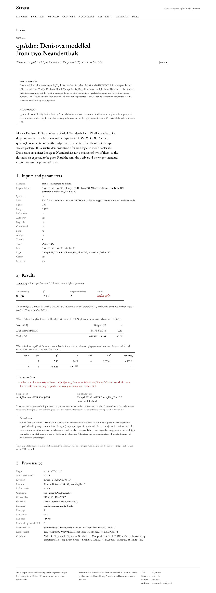

# Strata

*A research instrument for population genetics.*

Strata is an open-source web platform for computational population genetics. It places a
genome, or a set of Global25-style coordinates, among a curated library of ancient and
present-day reference populations; fits exploratory mixture models with bootstrap
uncertainty; runs formal qpAdm tests on f-statistics through ADMIXTOOLS 2; and lets an AI
research agent plan, run and critique those analyses, citing every number it reports.



## What it does

| | Exploratory | Formal |
|---|---|---|
| Method | Constrained least squares on PCA or G25 coordinates | qpAdm / qpWave / f4 on f-statistics (ADMIXTOOLS 2) |
| Question | Which mixture of sources lies closest to the target in this space? | Is the target consistent with descending from these sources, given outgroups? |
| Uncertainty | Bootstrap over source individuals; leave-one-source/dimension-out sensitivity; source rotation | Block-jackknife SE; rank-test tail probabilities; right-set rotation |
| Reading | A description of geometry. A good fit is not evidence of admixture | A model can be rejected. A model that is not rejected may still be wrong |

Strata keeps the two apart everywhere: in the engine's result types (`kind="exploratory"` /
`kind="formal"`), in reports, in the UI, and in the agent's tool design, which never ranks
exploratory and formal scores together.

**Inputs.** Raw DNA from 23andMe (v3–v5), AncestryDNA, FamilyTreeDNA, MyHeritage and Living
DNA, single-sample VCF (plain or gzip), and G25 coordinate sheets. Files are parsed in memory,
QC'd (call rate, heterozygosity, build inference, strand-ambiguous SNP removal), harmonised to
the reference SNP panel, and stored only as panel dosages under per-dataset envelope encryption.

**Analyses.** smartpca-style PCA with least-squares projection of sparse samples; nearest
populations; mixture fitting with three cross-checked solvers (exact active-set QP, NNLS with
sum-to-one constraint, SLSQP); bootstrap, rotation and sensitivity diagnostics; unbiased
f2/f3/f4 estimators with weighted block jackknife in NumPy; and qpAdm, qpAdm rotation, qpWave
and f4 through ADMIXTOOLS 2 in a containerised R worker.

**Research agent.** A provider-agnostic tool-calling loop (Anthropic Claude or OpenAI) with 13
tools over the real engine: library search, automatic proposal of source and outgroup sets,
exploratory fits, rotation, sensitivity, qpAdm, f4 and model comparison. Retrieval-augmented
over a methods corpus (BM25, optional dense retrieval and pgvector, reciprocal-rank fusion).
A deterministic grounding check flags any number in an answer that no tool returned. The agent
never sees genotypes, only derived coordinates and identifiers.

**Workspace.** Guest mode out of the box (24-hour encrypted workspace), optional Supabase
sign-in, saved analyses, dataset management, model comparison, and reproducible HTML/JSON
reports that record input hashes, parameters, software and reference-data versions.

## Worked examples

`data/examples/` holds real ADMIXTOOLS 2 computations, with inputs, outputs and provenance
(software versions, command, sha256 of parameters and results). They run on the f2 blocks
bundled with ADMIXTOOLS 2 (archaic hominins and Palaeolithic modern humans), so they show
genuine qpAdm behaviour, including a model whose high p-value is overruled by infeasible
weights. They are demonstrations of the method, not a South Asian analysis; examples on the
AADR reference panel are produced by the data pipeline.

## Architecture

```
apps/web             Next.js 15 · React 19 · TypeScript · Tailwind v4 · Plotly · D3   → Cloudflare Pages
services/api         FastAPI · NumPy · SciPy · scikit-learn · SQLAlchemy 2 · pydantic v2
  strata/io          vendor parsers, QC, harmonisation, EIGENSTRAT / PACKEDANCESTRYMAP I/O
  strata/analysis    PCA, distances, constrained admixture, f-statistics
  strata/qpadm       JSON bridge to R / ADMIXTOOLS 2
  strata/agent       LLM providers, tools, RAG, grounding check
  strata/jobs        Postgres job queue (FOR UPDATE SKIP LOCKED), worker, inline mode
  strata/security    Supabase JWT + guest tokens, AES-256-GCM envelope encryption, retention
services/worker      R 4.5 + ADMIXTOOLS 2 (pinned commit) + strata, as a container
data/pipeline        AADR download → QC → curated panel → PCA space → f2 cache → manifest
supabase/migrations  schema, row-level security, pgvector, pg_cron retention
infra                docker-compose for the full stack
```

Details: [`docs/ARCHITECTURE.md`](docs/ARCHITECTURE.md).

## Quick start

```bash
# API (SQLite, jobs run inline)
cd services/api
uv venv --python 3.12 .venv && uv pip install -p .venv/bin/python -e ".[dev]"
STRATA_JOB_MODE=inline .venv/bin/uvicorn strata.api.main:app --port 8000

# Formal tests (optional): R + ADMIXTOOLS 2 from conda-forge and GitHub
export STRATA_RSCRIPT="$(bash services/worker/r/install_env.sh)"

# Web
cd apps/web && cp .env.example .env.local && pnpm install && pnpm dev
```

Full stack: `docker compose -f infra/docker-compose.yml --env-file .env up --build`.
Production on Supabase, a container host and Cloudflare Pages:
[`docs/DEPLOYMENT.md`](docs/DEPLOYMENT.md). Every environment variable is documented in
[`.env.example`](.env.example).

## Tests

```bash
cd services/api && .venv/bin/pytest -q                 # engine, API, queue, security, agent, pipeline
STRATA_RSCRIPT=... .venv/bin/pytest -q -m r            # real ADMIXTOOLS 2 runs
cd apps/web && pnpm test && pnpm build && pnpm test:e2e
```

Synthetic data (msprime simulations, hand-written vendor files) is used only as test fixtures
and is labelled as such. CI runs all three suites ([`.github/workflows/ci.yml`](.github/workflows/ci.yml)).

## Data, licensing and privacy

* Reference data derive from the [Allen Ancient DNA Resource](https://doi.org/10.7910/DVN/FFIDCW)
  (Mallick et al. 2024). Strata redistributes derived metadata, coordinates and f-statistics,
  not AADR genotypes, and refuses the decommissioned AADR releases that exposed
  access-controlled samples. See [`docs/DATA_PROVENANCE.md`](docs/DATA_PROVENANCE.md).
* Strata does not ship Global25 reference sheets. Users may paste their own coordinates.
* Raw DNA never leaves the server unencrypted, is never logged and is never sent to a
  language model. Threat model: [`docs/SECURITY.md`](docs/SECURITY.md).

## Methods

The statistical methods, with references, are in [`docs/methods/`](docs/methods/) and are
rendered in the app under *Methods*. They also form the agent's retrieval corpus.

## Licence

AGPL-3.0-or-later ([`LICENSE`](LICENSE)). The worker image bundles ADMIXTOOLS 2, which is GPL-3.
